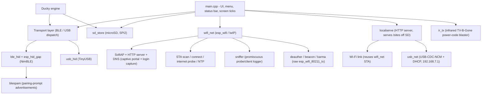

# Nexus

> A pocket cyberdeck firmware for the **M5Stack Cardputer** (ESP32-S3).

Nexus turns the Cardputer into a self-contained field tool: a **BLE / USB HID
device** (keyboard, mouse, gamepad), a **BadUSB / Ducky** payload runner, a
**microSD file browser**, and a full **Wi-Fi toolkit** (scanner, connect +
internet test, hotspot, captive / Evil-Twin portal, passive sniffer, plus
active deauth / beacon / Karma and BLE pairing-prompt spam) - all behind one
clean, keyboard-driven UI.

Built on bare **ESP-IDF v5.4** (no Arduino): **M5GFX** for the display,
**NimBLE** for Bluetooth, **TinyUSB** for native USB HID, and **esp_wifi /
lwIP** for networking.


---

## Features at a glance

| Area      | What it does |
|-----------|--------------|
| **BLE HID**   | Keyboard / mouse / gamepad over Bluetooth LE, with on-screen pairing PIN and bond management. |
| **USB HID**   | The same three controllers over a native USB-C cable (no pairing). |
| **Ducky**     | Runs DuckyScript payloads from the SD card over either BLE or USB. |
| **Storage**   | Browse / create / rename / delete files and folders on a microSD card. |
| **Wi-Fi**     | Scan networks, join one and verify real internet, run a hotspot, host a captive / Evil-Twin portal (with optional login capture), or passively sniff nearby probes/clients. Plus a live signal meter and NTP clock sync. |
| **RF attacks** | Wi-Fi **deauth** (broadcast or per-client, with associated-station discovery), **beacon** SSID spam, a **Karma** probe-response lure, and **BLE pairing-prompt spam** (Apple / Microsoft / Google). Own-gear / lab testing only. |
| **LocalServe** | Host static sites straight off the SD card - over Wi-Fi or a plain USB-C cable (USB-NCM). The Cardputer becomes a tiny web host. |
| **Infrared** | A universal TV-B-Gone-style IR remote: blast 202 built-in TV power codes to switch almost any television off (Blast), auto-find the one code that works (Find My TV), then save and re-send just that code (My TV). |

Everything is **lazy and mutually exclusive**: a radio or the SD card is powered
up only while you are inside its menu and fully torn down the moment you leave.
The display sprite stays allocated; radio and file-list buffers are acquired
on demand, important on a board with 512 KB SRAM and no PSRAM. USB-only
LocalServe does not initialize Wi-Fi.

---

## Navigation

The whole UI is driven from the Cardputer keyboard:

| Key | Action |
|-----|--------|
| `;` | up |
| `.` | down |
| `/` or `Enter` | select |
| `,` | back |
| `` ` `` | jump to root / exit a screen |

The always-on status bar shows battery (with charge bolt + low warning), the
die temperature (color-coded: dim under 50 C, amber 50-70, red above 70), and
the active transport: a BLE icon (dim = advertising, cyan = connected) or a USB
label. The temperature readout is toggleable and its sample rate is selectable
(2 / 5 / 10 / 30 / 60 s) under Settings.

---

## Feature detail

### LocalServe save reliability

Saves stream through an exclusive `.nexus-tmp` file, check buffered writes and
close errors, then move the previous file to `.nexus-bak` before replacement.
Failed replacement attempts restore the old file; if restoration also fails,
the backup is retained. This is **not power-loss atomic** on FATFS.

- Save bodies are limited to 4 MiB; larger requests receive HTTP 413.
- A leftover temporary file or ambiguous backup produces HTTP 409 instead of
  silently discarding data. Stop LocalServe and inspect those files on the SD
  card before removing them. A lone backup can be restored on the next save.
- Reserved sidecar names cannot be read or written through the HTTP API.
- Gzip twins are sent only when the client accepts gzip; SD I/O failures are
  distinguished from missing files, and interrupted reads close the response.
- This remains an unauthenticated local-network server. Use a trusted network;
  do not expose the save endpoint to the internet.

### UI performance and diagnostics

- Screens redraw on input, view changes, transport changes and scheduled status
  updates instead of continuously transferring a full sprite. Menu animation
  advances in the main loop rather than blocking keyboard polling.
- The existing `pdMS_TO_TICKS(16)` input delay is preserved (its actual duration
  depends on the FreeRTOS tick rate). Network status screens refresh at 1 Hz.
- `Settings > Memory` takes an on-demand snapshot of free heap, largest free
  block, heap low-water mark and main-task stack headroom. No background scan.
- `Settings > Power Save` opts into 80-240 MHz dynamic frequency scaling;
  default OFF preserves 240 MHz. Light sleep stays disabled for USB/input
  compatibility. Power savings and optional-mode latency are not benchmarked.
- Directory navigation rejects paths that exceed the buffer. Leaving Mouse
  sends a button-release report. Temperature failures display `--C`.


### BLE / USB HID (Control)

`BLE > Control` and `USB > Control` offer the same three screens; one speaks
Bluetooth, the other a native USB cable.

- **Keyboard** - transparent typing to the host. `Aa` = shift, `Enter` sends a
  real Enter, keystrokes echo on screen.
- **Mouse** - `;./,//` move the cursor; `s` cycles SLOW / MED / FAST; `space`
  left-click, `m` right, `n` middle; `k`/`j` scroll. Live L/R/M + scroll hints.
- **Gamepad** - 2 analog axes + 8 buttons with a live on-screen button grid.

BLE is **off at boot**, powers on only inside `BLE > Control`, and shows a fixed
pairing **PIN** on screen while advertising. `BLE > Forget Bonds` clears stored
pairings; `BLE > Info` shows name, MAC and link state.

USB HID is equally lazy. Because the ESP32-S3 USB-C port is shared between the
serial/flash interface and USB HID, Nexus uses serial on a normal boot (so it
stays flashable) and switches to USB HID only inside `USB > Control`. Restart to
return to flashable serial mode.

### Ducky (BadUSB)

`BLE > Duck` / `USB > Duck` run **DuckyScript** payloads stored as `.txt` files
in `/duck` on the SD card. Pick a script, confirm the host is connected, and
press Enter to run it; `` ` `` aborts mid-run. Supports `REM`, `STRING`,
`STRINGLN`, `DELAY`, `DEFAULT_DELAY`, and modifier combos (`GUI r`,
`CTRL ALT DELETE`, `ALT F4`, ...). Targets a US keyboard layout.

### Storage (microSD)

`Storage > Browse` is a full file manager for a microSD card (on its own SPI
bus, so it never collides with the display):

- Folder-first, alphabetical listing with human-readable sizes.
- Create files and folders, rename, and delete (files + empty folders) via an
  on-screen name entry.
- `;`/`.` scroll, `/` descend, `,` up, `Tab`/`Enter` opens an action sheet.

`Storage > Card Info` shows card name, size, filesystem and free space.

### Wi-Fi

`Wi-Fi` brings up the networking stack (and tears it down on exit). It is
mutually exclusive with BLE/USB by design.

- **Scan** - lists nearby APs with signal bars and open/secured coloring. Enter
  joins; `i` shows BSSID / channel / security / dBm; `r` rescans.
- **Connect + internet test** - join a network (password prompt for secured
  ones), then Nexus probes a known HTTP 204 endpoint and reports
  **Internet: YES / NO**. Associating is not the same as having internet - this
  catches dead gateways and captive portals. The status screen shows IP,
  gateway, and a **live RSSI signal meter** (walk around to find dead spots).
  `r` re-tests, `t` syncs the clock over **NTP**, `d` disconnects.
- **Hotspot** - a SoftAP with a name and password you choose (8+ chars = WPA2,
  blank = open). Shows the SSID, password, AP IP and a live client count.
- **Evil-Twin** - scan nearby Wi-Fi, pick a network to **clone its SSID**, then
  choose an `.html` page from the `/sites/captive` folder. Nexus stands up an open AP
  with the cloned name, a DNS catch-all (every lookup resolves to the device),
  and a web server that serves your page to anyone who joins. Live clients +
  page-hit counters. Press `g` on the page picker to drop three built-in phishing
  templates (`wifi.html`, `router.html`, `signin.html`) onto the card; any login
  form POSTed by a joined client is written to `/sites/captive/creds.log` and the
  screen shows a running **saved** count. (A device auto-joins on its own only if
  the trusted network was itself open; same-name WPA2 networks will not downgrade.
  Pair with **Deauth** to nudge clients off the real AP. Lab / own-gear use only.)

### RF attacks (lab / own-gear testing only)

These are **active** radio tools: they transmit, and in many places using them
against networks or devices you do not own is illegal. Keep them for your own
hardware, a lab, or explicit written authorization. All share the lazy teardown
rule - a tool runs only while you are on its screen and stops the moment you
leave (`,` or `` ` ``).

- **Wi-Fi > Deauth** - pick an AP from a scan, then Nexus passively discovers the
  **stations associated with it** (vendor-labelled, with RSSI and packet counts).
  Press `d` to deauth a selected client, or broadcast (`FF:FF:...`) to knock
  **every** client off, while the radio is parked on the AP's channel. Raw
  deauth / disassoc management frames are injected with `esp_wifi_80211_tx`; a
  program-wide `ieee80211_raw_frame_sanity_check()` override (plus the linker
  `--allow-multiple-definition` flag in `main/CMakeLists.txt`) lets them past the
  IDF frame filter. Live frames-sent counter.
- **Wi-Fi > Beacon** - floods 802.11 beacon frames for a built-in list of fake
  SSIDs, rotating channels 1 / 6 / 11 so they appear in nearby Wi-Fi lists. Each
  SSID keeps a stable locally-administered BSSID so it shows as one steady
  network. Live beacon count + channel.
- **Wi-Fi > Karma** - a probe-response lure: it listens for **directed probe
  requests** (phones hunting for their saved networks), harvests those SSIDs, and
  floods beacons + probe responses for each so the "known" networks appear in
  range and clients lean toward them. Shows harvested-SSID and frames-sent
  counts.
- **BLE > BLE Spam** - rapidly broadcasts fake pairing / proximity advertisements
  with a fresh random address each burst, popping "connect new device" prompts on
  nearby phones and PCs: Apple iOS proximity-pair, Windows Swift Pair, and Android
  Fast Pair (or all three at once). It borrows the NimBLE host from BLE HID, so it
  is **mutually exclusive with `BLE > Control`**. Live advertisements-sent counter.

### Infrared remote

`IR` is a universal infrared remote built on a TV-B-Gone-style power-code set
(202 codes: NEC / RC5 / Sony SIRC and raw timings).

- **Blast** - transmits all 202 TV power codes in sequence, so pointing the
  Cardputer at almost any television turns it off (or on). A live counter shows
  how far through the set it is.
- **Find My TV** - steps through the same set one code at a time so that, when a
  TV finally reacts, you can save the single code that worked.
- **My TV** - stores the code you found and re-sends just that one on demand.

IR is **send-only** (it drives the Cardputer's IR LED; there is no capture).

### LocalServe

`LocalServe` serves static sites straight off the SD card over your LAN, turning
the Cardputer into a small self-hosted web host, over Wi-Fi *or* a plain USB
cable.

- **Wireless (Wi-Fi)** - join a network (reusing the Wi-Fi scan/connect flow),
  then Nexus starts an HTTP server and serves files from `/sites` on the SD
  card, showing the `http://<ip>/` to open. Content type is set by extension,
  large files stream in chunks, a pre-compressed `.gz` twin is preferred when
  present, `PUT`/`POST /api/save/<path>` writes a file (temp + rename),
  `DELETE /api/save/<path>` removes one, and `GET /api/ls` lists a directory. If
  `/sites` has no `index.html`, a built-in launcher page is shown.
- **Wired (USB-NCM)** - the same server over a USB-C network link, no Wi-Fi or
  router needed. Nexus brings up a **USB-CDC-NCM** adapter (Windows 11 and Linux
  have built-in drivers; no install), runs a DHCP server on a private
  `192.168.7.1/24` link, and serves `/sites` at `http://192.168.7.1/`. Like USB
  HID it claims the shared USB-OTG port, so the serial console drops while it is
  active; restart to return to flashable serial mode.
- **HTTP proxy (`/api/fetch`)** - a dumb pass-through so a served page can reach
  any site without CORS. `GET /api/fetch?url=<abs http(s) url>` streams the
  upstream body straight back; `POST /api/fetch?url=...` relays the request body
  + `Content-Type` to the upstream. Optional `ref=`/`ua=` query params set the
  upstream `Referer`/`User-Agent`. TLS uses the IDF cert bundle; the body is
  never buffered whole, only streamed through a shared 2KB buffer.
- **Heap stat (`/api/stat`)** - returns `{"free","min_free","largest_block"}` so
  a page can watch RAM live.
- **Display-off RAM reclaim** - the first HTTP request frees the ~63KB display
  canvas and sleeps the panel, lifting the largest contiguous block from ~31KB to
  ~63KB so TLS fits in the 512KB / no-PSRAM budget. The screen goes dark; press
  the restart button to return to the menu (a clean boot restores the display).

A **Temp Debug** item under `Settings` reports the raw temperature-sensor
install / enable / read return codes - handy when bringing up new hardware.


### LocalServe HTTP API

Every served page talks to the firmware through these endpoints (all same-origin,
so CORS never applies). `httpd` runs a single worker; handlers stream through a
shared buffer and never buffer a whole file or response in RAM.

| Method | URI | Body | Returns |
|---|---|---|---|
| GET | `/` | - | `index.html` (or built-in launcher if `/sites` is empty) |
| GET | `/<path>` | - | static file / saved file; 404 if absent |
| PUT / POST | `/api/save/<path>` | file bytes | writes `/sites/<path>` (temp + atomic rename) |
| DELETE | `/api/save/<path>` | - | deletes `/sites/<path>` |
| GET | `/api/ls?path=<dir>` | - | JSON directory listing (`{"path","entries":[{"name","size","dir"}]}`); `/` lists the web root |
| GET | `/api/fetch?url=&ref=&ua=` | - | raw upstream body (status + Content-Type mirrored) |
| POST | `/api/fetch?url=&ref=&ua=` | relayed to upstream | raw upstream body |
| GET | `/api/stat` | - | `{"free":N,"min_free":N,"largest_block":N}` |
| GET | `/api/sniff.json` | - | live sniffer table (RAM) |

**Proxy.** `url` must be absolute `http(s)://` (else 400 `bad url`). On POST the
body and its `Content-Type` are relayed verbatim; `url`/`ref`/`ua` always stay in
the query string. Upstream connect failure -> 502 `{"error":"upstream connect
failed"}`. Timeout 15s. It is an open LAN relay (no host allowlist) - fine for a
personal device; add an allowlist if ever exposed beyond the LAN.

**Memory / store.** `/api/stat` is observability only; the reclaim is automatic
(see Display-off, above). The SD card is mounted once and kept mounted (a few
fixed KB, `max_files=4`); each file op is `fopen`/`fclose`, no handle is held
between calls. The "store" is just files: write with `/api/save/<path>`, read
back with plain `GET /<path>`. There is no key/value endpoint.

Sample calls:

```bash
# read a saved JSON file, then write it back
curl http://<ip>/data/library.json
curl -X POST --data-binary @library.json http://<ip>/api/save/data/library.json
# proxy a GET over TLS
curl "http://<ip>/api/fetch?url=https%3A%2F%2Fapi.github.com%2Frepos%2Fnikhilsaps%2FAtlas"
# proxy a POST (relays body + Content-Type to the upstream)
curl -X POST -H 'Content-Type: application/json' --data '{"query":"..."}' \
  "http://<ip>/api/fetch?url=https%3A%2F%2Fapi.example.com%2Fgraphql"
# heap stats
curl http://<ip>/api/stat
```

```js
// same-origin, from a page served off the card
const stat = await (await fetch('/api/stat')).json();
const text = await (await fetch('/api/fetch?url=' + encodeURIComponent(target))).text();
const resp = await (await fetch('/api/fetch?url=' + encodeURIComponent(apiUrl), {
  method: 'POST',
  headers: { 'Content-Type': 'application/json' },
  body: JSON.stringify(payload),
})).text();
await fetch('/api/save/data/settings.json', {
  method: 'POST',
  headers: { 'Content-Type': 'application/json' },
  body: JSON.stringify(settings),
});
```

---

### Wi-Fi Sniffer (probe / client logger)

A passive sniffer under **LocalServe -> Sniffer (NCM)**. The radio goes into
promiscuous mode and hops channels 1-13, logging nearby devices into a small
RAM table: probe requests (phones searching for saved network names), beacons /
APs, and connected data clients - each with MAC, SSID, RSSI, channel, hit count
and age. **Nothing is written to the SD** (metadata only; payloads are
encrypted and never captured).

The data is served over the **USB-NCM** link - radio and USB are separate
hardware, so the radio stays free to hop channels while USB carries the HTTP.
A `/api/sniff.json` endpoint streams the live table from RAM; the viewer page
at `/sites/sniff/index.html` on the SD polls it once a second and shows a
sortable table with CSV / JSON download. Open `http://192.168.7.1/sniff/` on
the wired PC. (Receive-only and lawful; the Evil-Twin step is the active part -
own gear only.)

---

## Companion repo: Nexus-Extras

The firmware is only half the kit. Everything Nexus *serves* lives in a separate
repo, **[Nexus-Extras](https://github.com/nikhilsaps/Nexus-Extras)** (the "Nexus
Sites" project): the microSD web root under `sites/` (the LocalServe launcher,
the Chess Master app, the Wi-Fi Sniffer viewer, and the Evil-Twin captive-portal
pages) plus the BadUSB payloads under `duck/`.

- **LocalServe** serves `sites/` straight off the card at `http://<device-ip>/`.
- **Evil-Twin** picks its pages from `sites/captive/`.
- **Wi-Fi Sniffer** streams into the viewer at `sites/sniff/index.html`.
- **Ducky** runs the `.txt` payloads from `duck/`.

Clone Nexus-Extras, build its apps, and deploy the tree to the card with its
`scripts/deploy.py` so the SD contents match this firmware's expectations. See
that repo's README for the full build-and-deploy flow.

## Hardware

- **Device:** M5Stack Cardputer (M5StampS3 / ESP32-S3FN8, 8 MB flash, **no PSRAM**)
- **Display:** ST7789 240x135 on SPI3
- **microSD:** dedicated SPI2 bus (SCK 40, MISO 39, MOSI 14, CS 12)
- **Toolchain:** ESP-IDF v5.4

> The real constraint is **512 KB SRAM** (no PSRAM), which is why Nexus keeps
> Wi-Fi, BLE/USB and the SD card strictly one-at-a-time and lazily allocated.

---

## Build & flash

```sh
idf.py set-target esp32s3
idf.py build
idf.py -p <PORT> flash monitor
```

The firmware boots over USB serial-JTAG, so it is always reflashable regardless
of which mode you were last in.

---

## Architecture



```
Nexus/
  README.md             this file
  CMakeLists.txt        ESP-IDF project
  sdkconfig.defaults    build config (source of truth)
  partitions.csv        partition table (8 MB flash)
  main/
    main.cpp            boot, UI, menu, status bar, all screen logic
    ble_hid.cpp/.h      composite NimBLE HID (keyboard + mouse + gamepad)
    esp_hid_gap.c/.h    BLE GAP / advertising / pairing
    usb_hid.cpp/.h      composite TinyUSB HID
    sd_store.cpp/.h     microSD mount + file ops (SPI2)
    wifi_net.cpp/.h     Wi-Fi: scan, connect, internet probe, hotspot,
                        captive portal (HTTP + DNS), NTP
    localserve.cpp/.h   SD-hosted static web server (/sites over the LAN)
    ir_tx.cpp/.h        infrared transmitter (TV-B-Gone-style power-code blaster)
    ir_codes.h          built-in IR power-code table (202 codes)
    usb_net.cpp/.h      USB-CDC-NCM adapter + esp_netif gateway + DHCP (Wired)
    sniffer.cpp/.h      promiscuous Wi-Fi sniffer + probe/client logger (RAM)
    deauther.cpp/.h     802.11 deauth/disassoc TX + associated-station discovery
    beacon.cpp/.h       802.11 beacon-spam transmitter (fake SSIDs, ch 1/6/11)
    karma.cpp/.h        Karma probe-response lure (harvest + respond)
    blespam.cpp/.h      BLE pairing-prompt advertisement spam (NimBLE)
```

---

## Regression checks

```sh
python tests/test_ui_guards.py
g++ -std=c++17 -Wall -Wextra -Werror tests/test_path_push.cpp -o test_path
./test_path
g++ -std=c++17 -Wall -Wextra -Werror -Imain tests/test_safe_replace.cpp -o test_save
./test_save
g++ -std=c++17 -Wall -Wextra -Werror tests/test_gzip.cpp -o test_gzip
./test_gzip
```

These host checks do not replace on-device UI, HID, SD-card and network tests.

## License

See [LICENSE](LICENSE).
