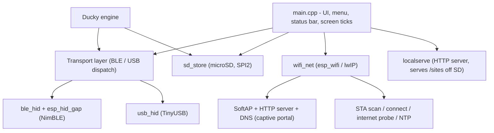

# Nexus

> A pocket cyberdeck firmware for the **M5Stack Cardputer** (ESP32-S3).

Nexus turns the Cardputer into a self-contained field tool: a **BLE / USB HID
device** (keyboard, mouse, gamepad), a **BadUSB / Ducky** payload runner, a
**microSD file browser**, and a full **Wi-Fi toolkit** (scanner, connect +
internet test, hotspot, and a captive portal) - all behind one clean,
keyboard-driven UI.

Built on bare **ESP-IDF v5.4** (no Arduino): **M5GFX** for the display,
**NimBLE** for Bluetooth, **TinyUSB** for native USB HID, and **esp_wifi /
lwIP** for networking.


---

## Features at a glance

| Area      | What it does |
|-----------|--------------|
| **BLE HID**   | Keyboard / mouse / gamepad over Bluetooth LE, with on-screen pairing PIN and bond management. |
| **USB HID**   | The same three controllers over a native USB-C cable (no pairing). |
| **Ducky**     | Runs DuckyScript payloads from the SD card over either BLE or USB. |
| **Storage**   | Browse / create / rename / delete files and folders on a microSD card. |
| **Wi-Fi**     | Scan networks, join one and verify real internet, run a hotspot, or host a captive portal. Plus a live signal meter and NTP clock sync. |
| **LocalServe** | Host static sites straight off the SD card over the LAN - the Cardputer becomes a tiny web host. |

Everything is **lazy and mutually exclusive**: a radio or the SD card is powered
up only while you are inside its menu and fully torn down the moment you leave.
On the idle root menu, Nexus holds almost no dynamic RAM - essential on a board
with 512 KB SRAM and no PSRAM.

---

## Navigation

The whole UI is driven from the Cardputer keyboard:

| Key | Action |
|-----|--------|
| `;` | up |
| `.` | down |
| `/` or `Enter` | select |
| `,` | back |
| `` ` `` | jump to root / exit a screen |

The always-on status bar shows battery (with charge bolt + low warning), the
die temperature (color-coded: dim under 50 C, amber 50-70, red above 70), and
the active transport: a BLE icon (dim = advertising, cyan = connected) or a USB
label. The temperature readout is toggleable and its sample rate is selectable
(2 / 5 / 10 / 30 / 60 s) under Settings.

---

## Feature detail

### BLE / USB HID (Control)

`BLE > Control` and `USB > Control` offer the same three screens; one speaks
Bluetooth, the other a native USB cable.

- **Keyboard** - transparent typing to the host. `Aa` = shift, `Enter` sends a
  real Enter, keystrokes echo on screen.
- **Mouse** - `;./,//` move the cursor; `s` cycles SLOW / MED / FAST; `space`
  left-click, `m` right, `n` middle; `k`/`j` scroll. Live L/R/M + scroll hints.
- **Gamepad** - 2 analog axes + 8 buttons with a live on-screen button grid.

BLE is **off at boot**, powers on only inside `BLE > Control`, and shows a fixed
pairing **PIN** on screen while advertising. `BLE > Forget Bonds` clears stored
pairings; `BLE > Info` shows name, MAC and link state.

USB HID is equally lazy. Because the ESP32-S3 USB-C port is shared between the
serial/flash interface and USB HID, Nexus uses serial on a normal boot (so it
stays flashable) and switches to USB HID only inside `USB > Control`. Restart to
return to flashable serial mode.

### Ducky (BadUSB)

`BLE > Duck` / `USB > Duck` run **DuckyScript** payloads stored as `.txt` files
in `/duck` on the SD card. Pick a script, confirm the host is connected, and
press Enter to run it; `` ` `` aborts mid-run. Supports `REM`, `STRING`,
`STRINGLN`, `DELAY`, `DEFAULT_DELAY`, and modifier combos (`GUI r`,
`CTRL ALT DELETE`, `ALT F4`, ...). Targets a US keyboard layout.

### Storage (microSD)

`Storage > Browse` is a full file manager for a microSD card (on its own SPI
bus, so it never collides with the display):

- Folder-first, alphabetical listing with human-readable sizes.
- Create files and folders, rename, and delete (files + empty folders) via an
  on-screen name entry.
- `;`/`.` scroll, `/` descend, `,` up, `Tab`/`Enter` opens an action sheet.

`Storage > Card Info` shows card name, size, filesystem and free space.

### Wi-Fi

`Wi-Fi` brings up the networking stack (and tears it down on exit). It is
mutually exclusive with BLE/USB by design.

- **Scan** - lists nearby APs with signal bars and open/secured coloring. Enter
  joins; `i` shows BSSID / channel / security / dBm; `r` rescans.
- **Connect + internet test** - join a network (password prompt for secured
  ones), then Nexus probes a known HTTP 204 endpoint and reports
  **Internet: YES / NO**. Associating is not the same as having internet - this
  catches dead gateways and captive portals. The status screen shows IP,
  gateway, and a **live RSSI signal meter** (walk around to find dead spots).
  `r` re-tests, `t` syncs the clock over **NTP**, `d` disconnects.
- **Hotspot** - a SoftAP with a name and password you choose (8+ chars = WPA2,
  blank = open). Shows the SSID, password, AP IP and a live client count.
- **Captive Portal** - choose a hotspot name, then pick an `.html` page from the
  `/captive` folder on the SD card. Nexus starts an open AP with that name, a
  DNS catch-all (every lookup resolves to the device), and a web server that
  serves your page to anyone who joins - so phones auto-pop the "sign in to
  network" page. Live clients + page-hit counters.

### LocalServe (work in progress)

`LocalServe` serves static sites straight off the SD card over your LAN, turning
the Cardputer into a small self-hosted web host.

- **Wireless (Wi-Fi)** - join a network (reusing the Wi-Fi scan/connect flow),
  then Nexus starts an HTTP server and serves files from `/sites` on the SD
  card, showing the `http://<ip>/` to open. Content type is set by extension,
  large files stream in chunks, a pre-compressed `.gz` twin is preferred when
  present, and `PUT`/`POST /api/save/<path>` writes a file (temp + rename). If
  `/sites` has no `index.html`, a built-in launcher page is shown.
- **Wired (RNDIS)** - the same server over a USB network link - coming in a
  later update.

> Status: on-device web serving is still being verified; the menu, server and
> SD plumbing are in place.

A **Temp Debug** item under `Settings` reports the raw temperature-sensor
install / enable / read return codes - handy when bringing up new hardware.

---

## Hardware

- **Device:** M5Stack Cardputer (M5StampS3 / ESP32-S3FN8, 8 MB flash, **no PSRAM**)
- **Display:** ST7789 240x135 on SPI3
- **microSD:** dedicated SPI2 bus (SCK 40, MISO 39, MOSI 14, CS 12)
- **Toolchain:** ESP-IDF v5.4

> The real constraint is **512 KB SRAM** (no PSRAM), which is why Nexus keeps
> Wi-Fi, BLE/USB and the SD card strictly one-at-a-time and lazily allocated.

---

## Build & flash

```sh
idf.py set-target esp32s3
idf.py build
idf.py -p <PORT> flash monitor
```

The firmware boots over USB serial-JTAG, so it is always reflashable regardless
of which mode you were last in.

---

## Architecture



```
Nexus/
  README.md             this file
  CMakeLists.txt        ESP-IDF project
  sdkconfig.defaults    build config (source of truth)
  partitions.csv        partition table (8 MB flash)
  main/
    main.cpp            boot, UI, menu, status bar, all screen logic
    ble_hid.cpp/.h      composite NimBLE HID (keyboard + mouse + gamepad)
    esp_hid_gap.c/.h    BLE GAP / advertising / pairing
    usb_hid.cpp/.h      composite TinyUSB HID
    sd_store.cpp/.h     microSD mount + file ops (SPI2)
    wifi_net.cpp/.h     Wi-Fi: scan, connect, internet probe, hotspot,
                        captive portal (HTTP + DNS), NTP
    localserve.cpp/.h   SD-hosted static web server (/sites over the LAN)
```

---

## License

See [LICENSE](LICENSE).
